<p align="center">
  
</p>

<h1 align="center">MilestoneSpace</h1>

<p align="center">A personal desktop workspace for tracking projects, milestones, tasks and deadlines.<br />
Offline, private, and made for freelancers who juggle client work, side projects and study.</p>

<p align="center">
  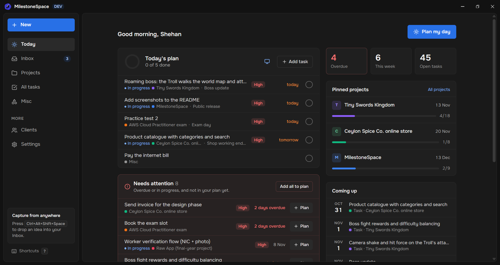
</p>

## Why MilestoneSpace

**It works completely offline.** There is no account, no server, no subscription and no sync. Everything
lives in one SQLite file on your own computer, so the app opens instantly, works on a train or during a
power-cut-and-hotspot afternoon, and your clients' details never leave your machine. Automatic backups
(and a one-click restore) keep that file safe.

**It's built for freelancers.** A typical week mixes a couple of client jobs, a finished project waiting
for a testimonial, your own app, a side game and a university module. MilestoneSpace keeps all of them
in one place without turning into a team tool:

- **Clients and their projects**: each client has a page with its projects and notes ("prefers WhatsApp,
  calls before noon").
- **Everything about a job in one project**: milestones and deadlines, tasks on a list or a Kanban board,
  links to the repo, Figma, Drive or the store page, and details like your rate, the fixed price and what's
  been paid, the package name or a staging login, one click to copy.
- **A plan for today**: pick tasks from every project each morning and work down one list. Overdue and
  due-soon work is flagged for you, and Windows reminders nudge you before deadlines.
- **Capture without switching**: a client calls mid-task? Press a global shortcut, type it, press Enter.
  It waits in the Inbox (or goes straight to a project or today's list).
- **Always within reach**: the app sits in the tray, starts with Windows, and a small Today widget keeps
  your plan on the desktop.

## Tour

### Today
The start page. Tasks you picked for today from all your projects, what needs attention (overdue and due
soon), quick stats, pinned projects and what's coming up this week. Press **P** to pick today's tasks.

### Projects
Client, personal and study projects, each with a color, status, progress and deadline. Pin the ones you're
focused on; completed projects can move to an archive.

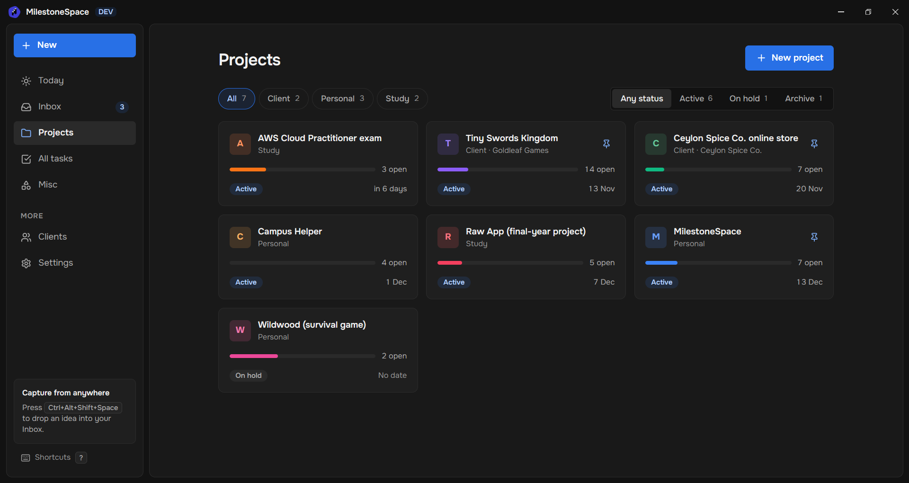

### A project
The **Overview** shows progress, the next milestone, the deadline and the nearest tasks.

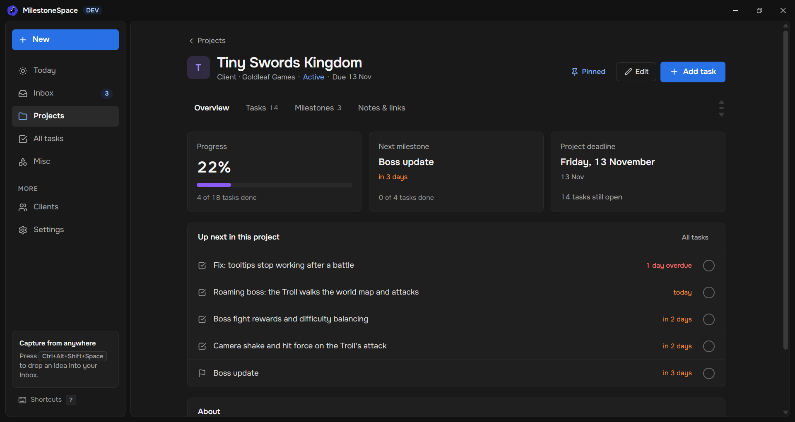

**Tasks** can be a list or a **Kanban board** (To do / In progress / Done) with drag and drop, filtered by
milestone. Tasks you're not ready for can go to the project's **Stash**, out of every list until you need them.

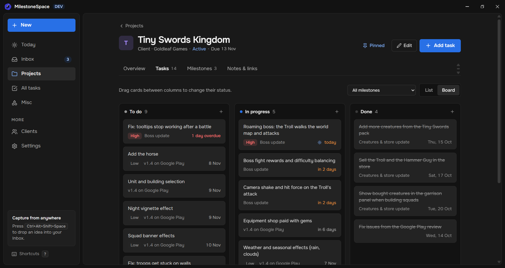

**Milestones** show as a timeline; expand one to see its tasks.

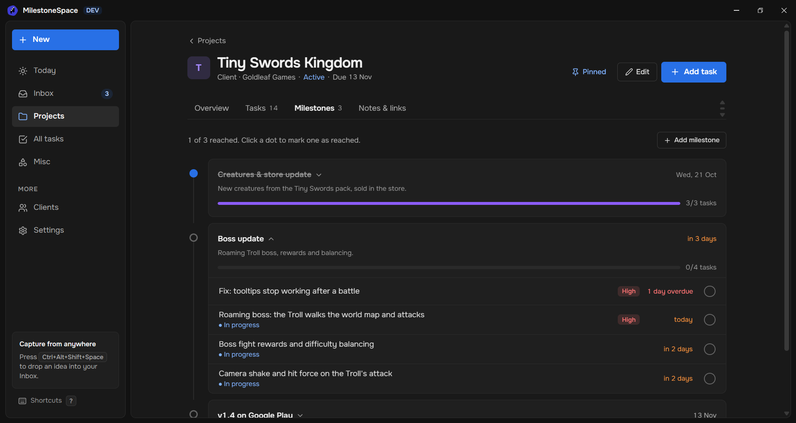

**Notes & links**: Keep-style note cards in markdown (checklists, pinning, colors, drag to reorder), links
that open in your browser or Explorer, and label/value details with one-click copy.

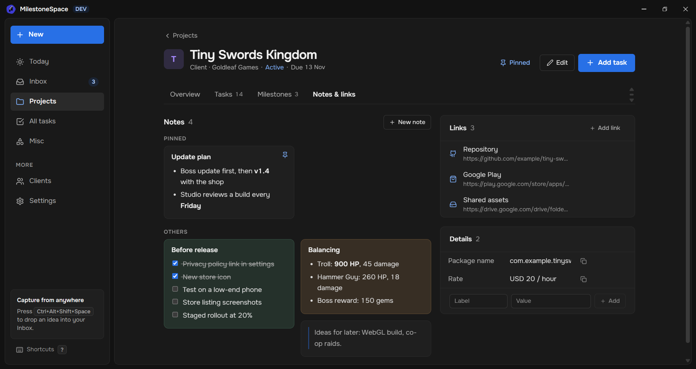

### All tasks
Every task across all projects, grouped by project and filterable by status, priority and project.

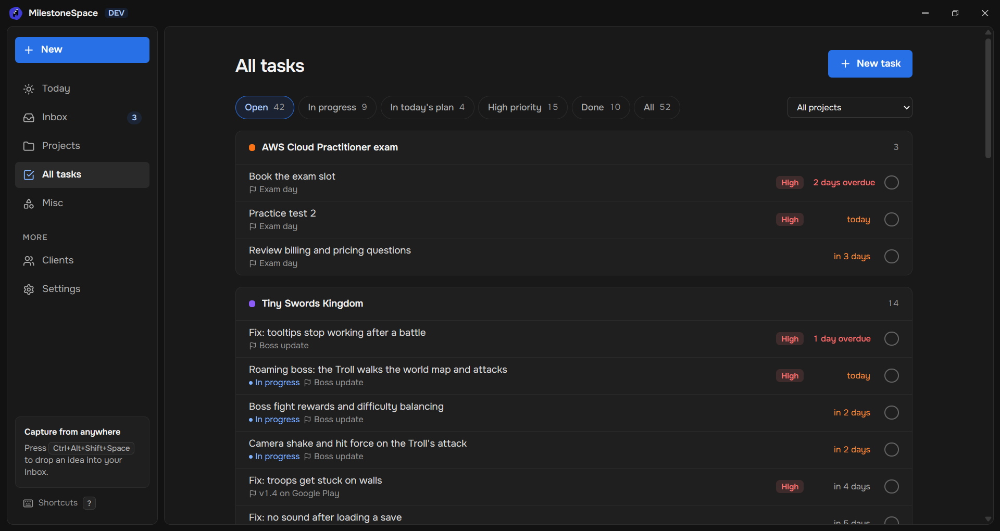

### Inbox and quick capture
Ideas land in the Inbox and become tasks later. **Ctrl+Shift+Space** opens quick capture from any app, even
with MilestoneSpace hidden; ←/→ send it to Today, a project or Misc instead, ↑/↓ pick the project.

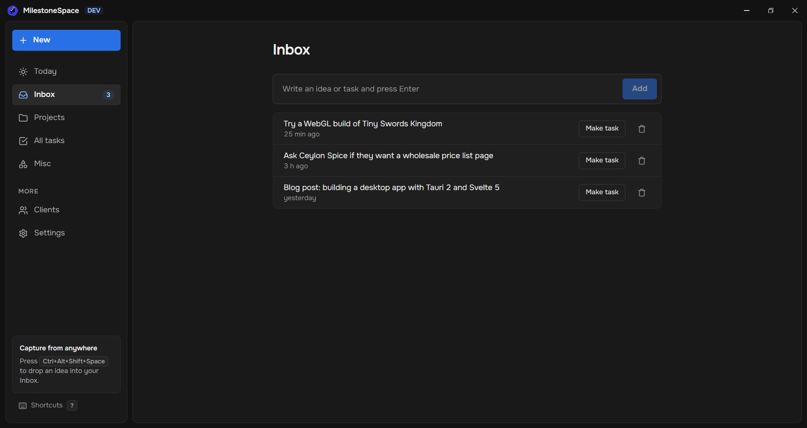

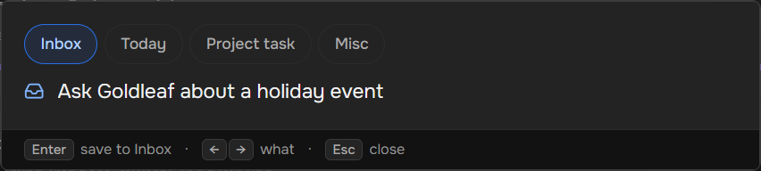

### New
The sidebar's **New** button (or **N**) adds a task for today, a project task, an Inbox idea, a Misc task or
a whole project in one line.

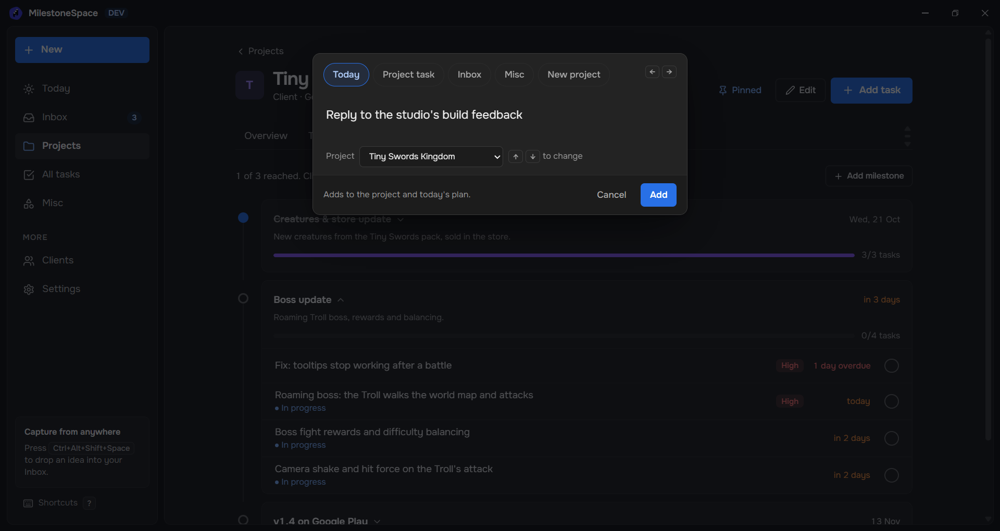

### Misc
Small everyday jobs that don't belong to a project ("pay the internet bill"): just a title, a priority and
done. They can be planned for today too.

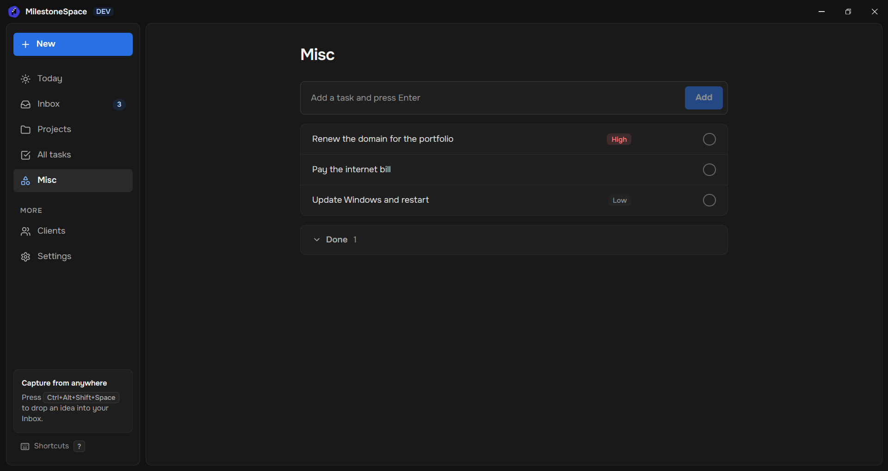

### Clients
A client's page shows their projects and notes.

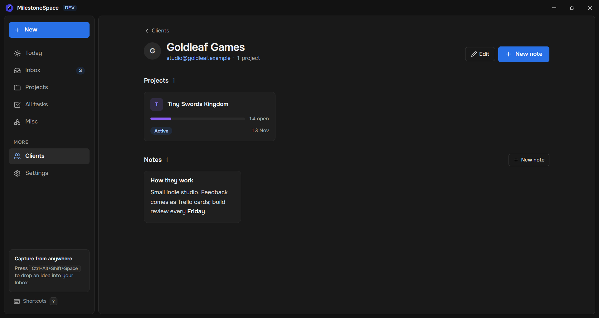

### Today widget
Today's plan in a small window on your desktop. Check tasks off, add one for today, or click a task to open
it in the app. It stays on the desktop, even through Win+D.

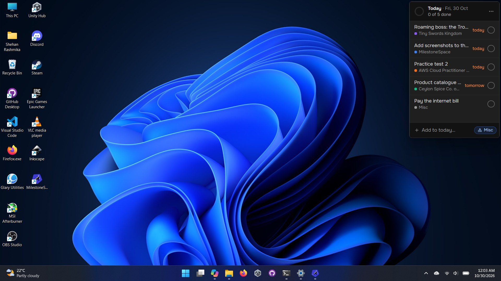

### Settings
Five color themes (Aurora, Midnight, Deep Ocean, Daylight, Sand) and an accent color, text size and spacing,
date and time formats, reminders and quiet hours, the quick capture shortcut, backups and more.

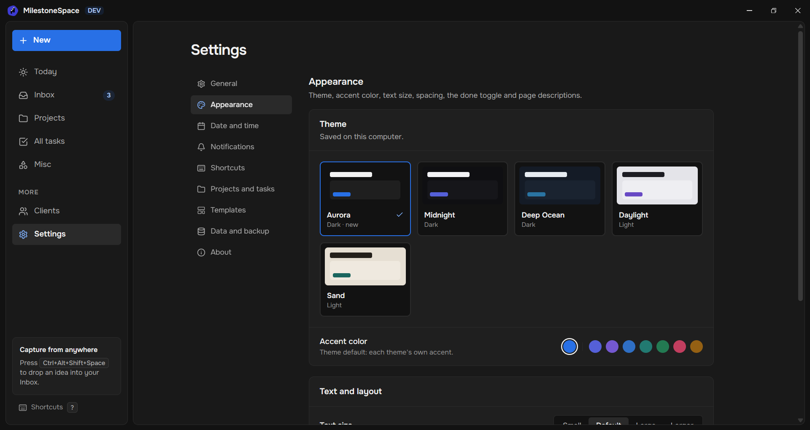

## Features

- **Today**: plan the day from all projects; needs attention, stats, pinned projects, coming up, and a
  Getting started checklist.
- **Projects** (client, personal, study) with color, status, deadline and pinning; completed projects can
  be archived.
- **Project page** tabs: Overview, Tasks (list or Kanban board, Stash), Milestones (timeline), Notes & links.
- **Tasks** with priorities, due dates and milestones; friendly deadlines (overdue in red, due within
  3 days in orange).
- **Note cards** for projects and clients: markdown, clickable checklists, colors, pinning, reorder by drag.
- **Links and details** per project; open a project's local folder in Explorer or VS Code.
- **Inbox** and **quick capture** from anywhere with a global shortcut.
- **Misc tasks** for small everyday jobs.
- **All tasks** with filters, and **Clients** with their own pages.
- **Today widget** on the desktop.
- **Reminders**: Windows notifications for deadlines, a daily summary, quiet hours.
- **Backups**: automatic backups to a folder you choose, manual backup and restore.
- **Themes**: 5 color themes plus an accent color.
- **Keyboard first**: shortcuts everywhere (press **?**), and Undo (Ctrl+Z) after deleting a task, note or link.
- Runs in the tray and can start with Windows.

## Tech stack

- [Tauri 2](https://tauri.app/) (Rust) for the desktop shell
- [SvelteKit](https://svelte.dev/) with Svelte 5 runes and TypeScript, as a static single-page app
- [Tailwind CSS v4](https://tailwindcss.com/)
- SQLite through [tauri-plugin-sql](https://v2.tauri.app/plugin/sql/), with versioned migrations
- [marked](https://marked.js.org/) and [DOMPurify](https://github.com/cure53/DOMPurify) for notes

## Getting started

Prerequisites: [Node.js](https://nodejs.org/) 24+ (the sample data script uses the built-in `node:sqlite`),
[Rust](https://www.rust-lang.org/tools/install), and the
[Tauri prerequisites](https://v2.tauri.app/start/prerequisites/) for your platform.

```bash
npm install
npm run tauri dev     # run the app in development
npm run tauri build   # build an installer
```

Other scripts:

```bash
npm run seed:dev              # add the sample projects from the screenshots to the dev database
npm run seed:dev -- --reset   # empty the dev database first
npm run check                 # type-check and lint the Svelte code
npm run build                 # build the frontend only
```

## Data

The database is created on first launch at `%APPDATA%\com.shehan.milestonespace\tracker.db` on Windows
(the folder comes from the app `identifier` in `src-tauri/tauri.conf.json`). The development build uses
`tracker-dev.db` in the same folder, so trying things out never touches your real data. Schema changes are
applied automatically by the migrations in `src/lib/migrations.ts`. Backups go to the `backups` folder next
to the database unless you pick another one in Settings → Data and backup.

## Project structure

```
src/
  lib/
    db.ts            all SQL queries (typed functions per table)
    migrations.ts    schema migrations, tracked with PRAGMA user_version
    types.ts         shared types
    theme.ts         color themes
    components/      reusable UI components
  routes/            pages: Today, inbox, projects, tasks, misc, clients, settings,
                     plus the quick capture and widget windows
src-tauri/           Tauri (Rust) app, config and icons
scripts/seed-dev.mjs sample data for the dev database
docs/screenshots/    the screenshots in this README
```
