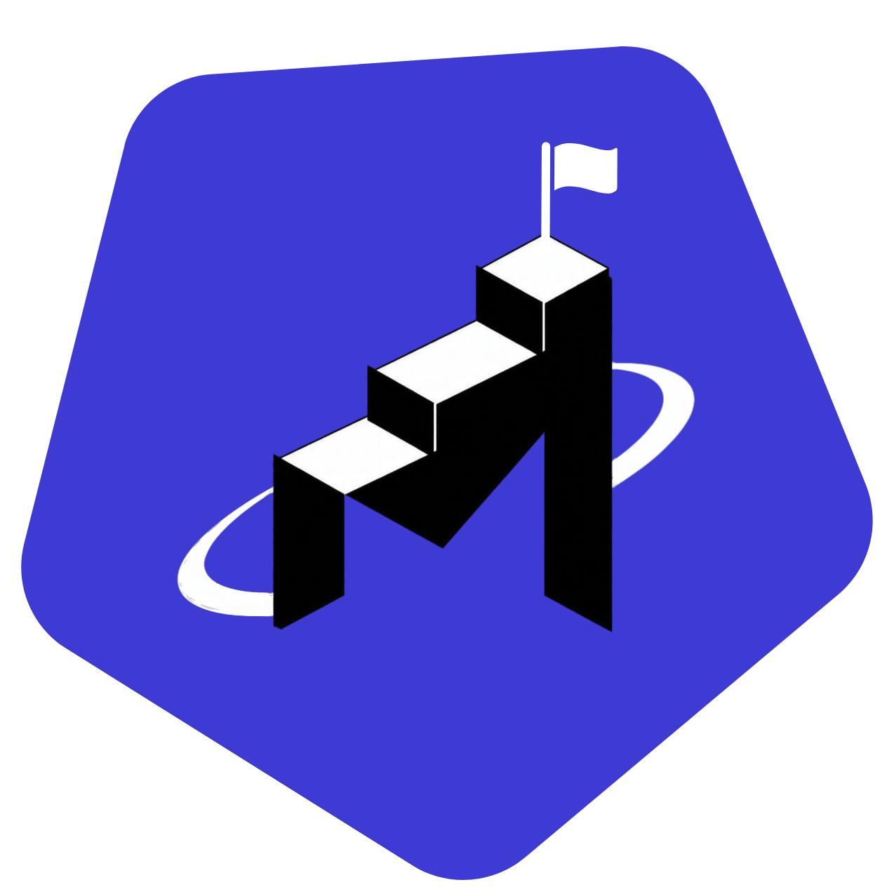

<p align="center">
  
</p>

<h1 align="center">MilestoneSpace</h1>

<p align="center">A personal desktop workspace for tracking projects, milestones, tasks and deadlines.</p>

MilestoneSpace is a local-first desktop app for keeping client work, personal projects and
study in one place. Everything is stored in a local SQLite database on your computer: no account,
no server, no sync.

## Features

- **Projects**: client, personal or study projects, each with a color, status and deadline.
- **Project page** with tabs:
  - **Overview**: progress, the next milestone, the deadline and the nearest upcoming tasks and milestones.
  - **Tasks** and **Milestones**: priorities, due dates, and tasks linked to milestones. Tasks can
    be shown as a list or as a **Kanban board** (To do / In progress / Done) with drag and drop,
    filtered by milestone. Milestones show as a timeline.
  - **Notes & links**: markdown notes that save automatically, links (GitHub, Figma, Drive, store pages,
    local folders...) that open in your browser or Explorer, and custom label/value details
    with one-click copy.
- **Today**: pick the tasks you'll do today from all projects; the app opens on this list. It also
  shows what needs attention, pinned projects, what's coming up, and a Getting started checklist.
- **New** (sidebar button or **N**): add a task for today, an idea for the Inbox, or a project in one line.
- **Quick capture**: press **Ctrl+Shift+Space** anywhere, even with the app hidden, type an idea
  and press Enter. It lands in the **Inbox**, where you turn items into tasks later. ←/→ send it to
  Today, a project or Misc instead (↑/↓ pick the project). The box stays open for the next one; Esc closes it.
- **Project folders**: save each project's local folder and open it in Explorer or VS Code.
- **Keyboard shortcuts** throughout the app (press **?** to see them).
- Runs in the tray: closing the window keeps it running, and it can start with Windows.
- **All tasks**: every task across all projects, grouped by project and filterable by status,
  priority and project.
- **Clients**: optional clients for client projects.
- **Themes**: Aurora (the default: neutral graphite with a blue accent), two more dark and two light
  color themes, picked from Settings.
- Friendly deadlines: overdue in red, due within 3 days in orange.

## Tech stack

- [Tauri 2](https://tauri.app/) (Rust) for the desktop shell
- [SvelteKit](https://svelte.dev/) with Svelte 5 runes and TypeScript, as a static single-page app
- [Tailwind CSS v4](https://tailwindcss.com/)
- SQLite through [tauri-plugin-sql](https://v2.tauri.app/plugin/sql/), with versioned migrations
- [marked](https://marked.js.org/) and [DOMPurify](https://github.com/cure53/DOMPurify) for note previews

## Getting started

Prerequisites: [Node.js](https://nodejs.org/) 20+, [Rust](https://www.rust-lang.org/tools/install), and the
[Tauri prerequisites](https://v2.tauri.app/start/prerequisites/) for your platform.

```bash
npm install
npm run tauri dev     # run the app in development
npm run tauri build   # build an installer
```

Other scripts:

```bash
npm run check   # type-check and lint the Svelte code
npm run build   # build the frontend only
```

## Data

The database is created on first launch at `%APPDATA%\com.shehan.milestonespace\tracker.db` on Windows
(the folder comes from the app `identifier` in `src-tauri/tauri.conf.json`). Schema changes are applied
automatically by the migrations in `src/lib/migrations.ts`. Back up that file to keep your data safe.

## Project structure

```
src/
  lib/
    db.ts            all SQL queries (typed functions per table)
    migrations.ts    schema migrations, tracked with PRAGMA user_version
    types.ts         shared types
    theme.ts         color themes
    components/      reusable UI components
  routes/            pages: today, inbox, projects, tasks, clients, settings
src-tauri/           Tauri (Rust) app, config and icons
```
